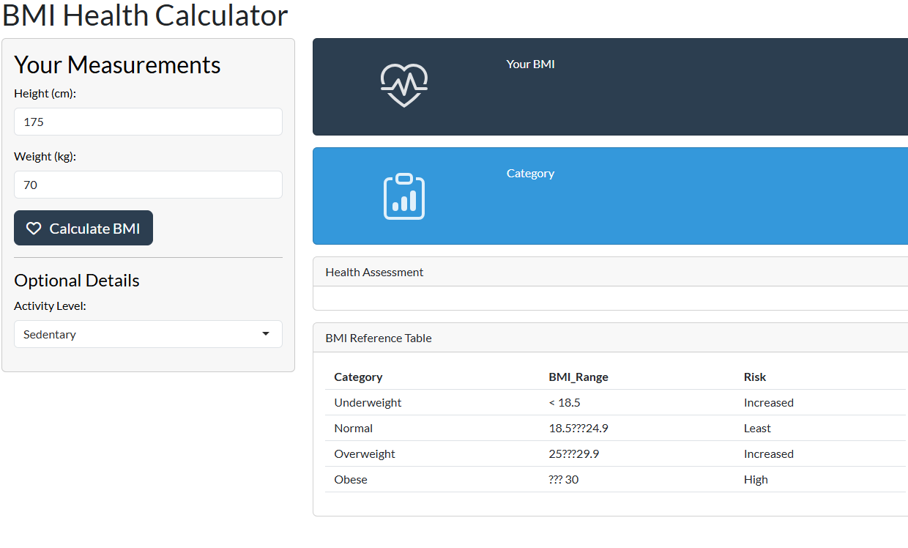

# BMI Health Calculator

> Portfolio App #1 of 15 + Tier 1 - Fundamentals

An interactive BMI (Body Mass Index) calculator built with R and Shiny. First app in a structured portfolio roadmap designed to demonstrate enterprise-grade Shiny development skills.



---

## Problem

Users need a fast, trustworthy way to calculate BMI, understand what the number means, and get actionable health guidance ??? without ads or sketchy calculator sites.

## Solution

A single-page Shiny app that:
- Validates user inputs before calculating
- Computes BMI with clear category classification
- Displays an ideal weight range based on height
- Provides contextual health recommendations
- Uses color-coded value boxes for at-a-glance reading

---

## Tech Stack

| Layer | Tool |
|-------|------|
| Framework | R + Shiny |
| Theming | bslib (`flatly` Bootswatch) |
| UI Widgets | shinyWidgets, bsicons |
| Data Manipulation | dplyr |
| Deployment | shinyapps.io |

---

## What This Demonstrates

- ??? **Reactive expressions** ??? `eventReactive()` for on-demand calculation
- ??? **Input validation** ??? `req()` and `validate(need(...))` to guard against bad inputs
- ??? **Conditional UI** ??? `conditionalPanel()` reacting to `selectInput` state
- ??? **Modern layout** ??? `value_box()`, `card()`, and `bslib` theming
- ??? **Reactive debugging** ??? `observe()` for tracing reactive graph invalidations
- ??? **Deployment** ??? published to shinyapps.io

---

## Running Locally

```r
# Install dependencies
install.packages(c("shiny", "bslib", "shinyWidgets", "bsicons", "dplyr"))

# Run the app
shiny::runApp()
```

Or clone, open `app.R` in RStudio, and click **Run App**.

---

## Project Structure

```
shiny-portfolio-01-bmi-calc/
????????? app.R           # Single-file Shiny app (UI + server)
????????? README.md
????????? screenshot.png
????????? www/            # (optional) custom CSS/assets
```

---

## Roadmap Context

This app is **#1** in a 45-app portfolio roadmap:

- **Tier 1 ??? Fundamentals (1???10):** reactivity, layout, basic UX
- **Tier 2 ??? Intermediate (11???25):** modules, SQL, auth, custom JS
- **Tier 3 ??? Advanced (26???40):** custom input bindings, async/promises, performance
- **Tier 4 ??? Centerpieces (41???45):** flagship, product-quality apps

**Skill checkpoint reached:** reactive graph intuition, input validation, `bslib` theming, shinyapps.io deployment.

---

## Skills Matrix

| Skill | Status |
|-------|--------|
| Reactive expressions | ??? |
| Input validation (`req`, `validate`) | ??? |
| Conditional UI | ??? |
| bslib theming | ??? |
| Deployment (shinyapps.io) | ??? |
| Git / GitHub workflow | ??? |
| Custom JS | ??? (Tier 2+) |
| SQL backend | ??? (Tier 2+) |
| Async / promises | ??? (Tier 3+) |

---

## Future Improvements

- [ ] Add body fat percentage calculator
- [ ] Add heart rate zone calculator
- [ ] Persist calculation history (SQLite backend)
- [ ] Downloadable PDF health report (`rmarkdown`)
- [ ] Refactor logic into a separate `R/` module

---

## License

MIT