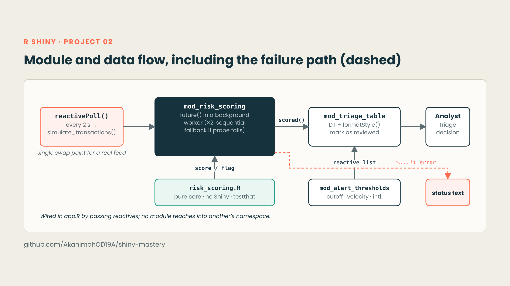
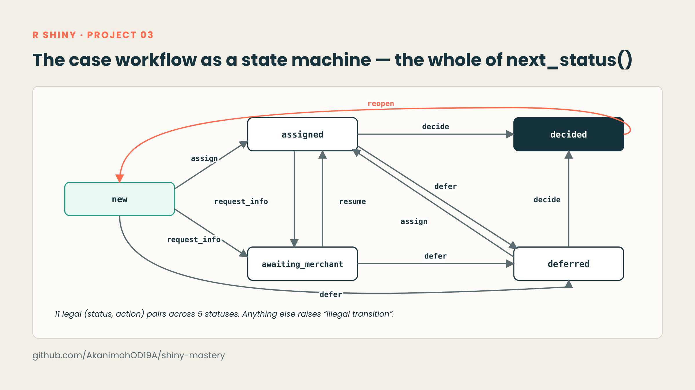
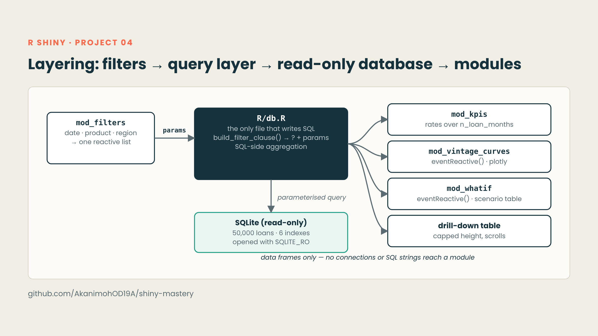

# shiny-mastery

A tiered portfolio of R Shiny applications, built to practise the engineering side of Shiny: modules, async processing, testable business logic, a real data layer, and reproducible delivery.

**Read the review:** [`docs/rshiny-portfolio-report.pdf`](docs/rshiny-portfolio-report.pdf) is an 11-page walkthrough of the four projects below: architecture diagrams, screenshots, key code and the engineering decisions behind each one.

## Projects

| # | Project | What it demonstrates |
|---|---------|----------------------|
| 01 | [BMI Calculator](01-bmi-calc) | Gated computation with `eventReactive()`, validated inputs, `bslib` layout |
| 02 | [Fraud Monitoring Dashboard](02-fraud-dashboard) | Three Shiny modules, `reactivePoll()`, async scoring with `future`/`promises`, a pure scoring core, `testthat`, `renv`, CI |
| 03 | [Merchant Compliance & KYC Review Console](03-merchant-compliance-and-kyc-review-console) | Workflow as a state machine, policy as pure functions, audit trail, debounced search, async sanctions screening, `testthat`, `renv`, CI on Windows and Ubuntu |
| 04 | [Credit Risk & Vintage Analytics Explorer](04-credit-risk-explorer) | SQL data layer, parameterised queries, read-only connection, aggregation in the database over 50,000 simulated loans |

## Architecture at a glance

**02 · Fraud monitoring: module and data flow**



**03 · KYC console: the case workflow as a state machine**



**04 · Credit risk explorer: layering**



## Running a project

Open the project folder as the working directory, then:

```r
# 02 and 03 pin their dependencies with renv
renv::restore()
shiny::runApp()
```

Project 04 builds its demo database from a script, because the binary is not committed:

```r
# from inside 04-credit-risk-explorer/
source("data/seed_db.R")   # creates data/portfolio.db (set.seed(2024))
shiny::runApp()
```

Project 01 is a single `app.R`; see its [README](01-bmi-calc/README.md).

## Design principles across the projects

- **Policy separated from presentation:** business rules are plain R functions that can be tested without launching Shiny.
- **State as data:** the KYC workflow is a transition table, and the audit trail is append-only.
- **Heavy work off the UI thread:** scoring and sanctions screening run in workers, with error handlers.
- **Data access isolated:** all SQL lives in one file, parameterised, on a read-only connection.
- **Reproducible by default:** `renv` lockfiles, seeded data scripts, CI workflows.

## Roadmap

- Real authentication and persistent audit storage for 03
- A live transaction feed behind the same interface as `simulate_transactions()` in 02
- `shinytest2` end-to-end tests
- Tests, CI and `renv` for 04, plus profiling at larger volume

## Author

Daniel Amah · [akandaniel.netlify.app](https://akandaniel.netlify.app) · [GitHub](https://github.com/AkanimohOD19A)
